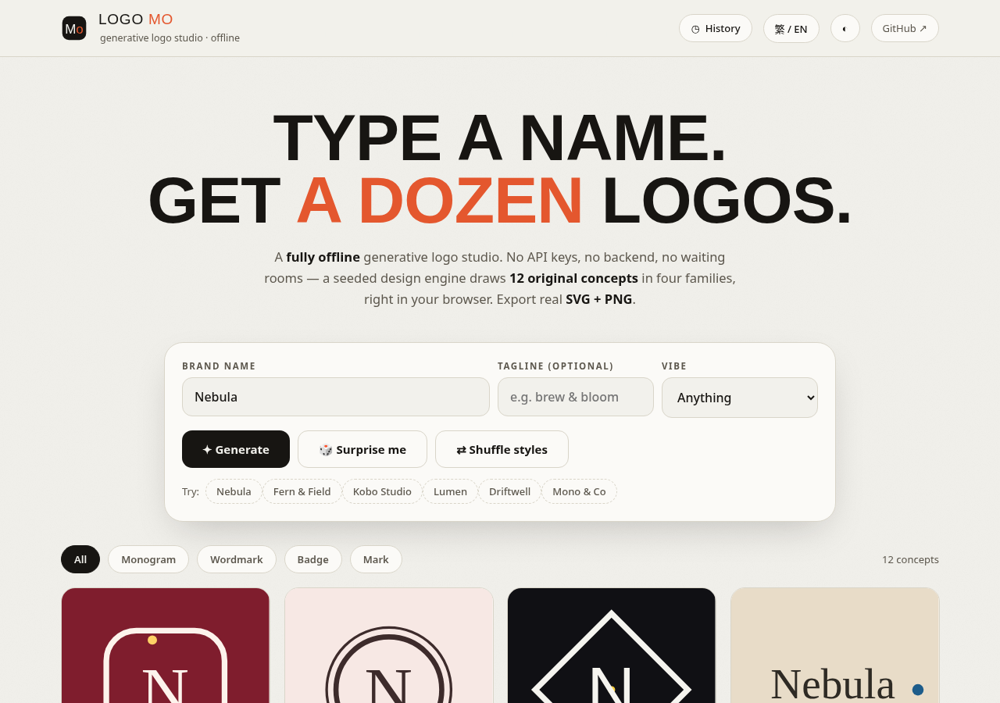

# Logo Mo — Professional Logo Prompt Studio

**Type the basics. Get 12 pro prompts.** A fully offline logo prompt studio: type a brand name and a few basic requirements, and Logo Mo writes **12 professional, precise logo prompts** — one per design approach. Copy any prompt and generate the real logo in **Midjourney, Flux, Ideogram or DALL·E**.

**Live demo:** https://artzdesignmo.github.io/logo-mo/

## Why prompts, not auto-drawn logos?

The first versions of Logo Mo drew logos procedurally in the browser. They were fast — and rough. A professional logo prompt, written precisely and pasted into a real image model, produces a far better logo. So v3 flips the job: Logo Mo writes the prompt; your favourite AI draws the logo. The small picture on each card is a **reference preview only**, not the finished logo.

## The 12 approaches

One card per design direction — each a different way to design the same brand:

1. **Minimal Geometric** — one clean geometric mark, circles and triangles only
2. **Luxury Monogram** — interlocked initials, hairline strokes, gold on charcoal
3. **Modern Wordmark** — the name itself is the logo, one custom letter detail
4. **Friendly Mascot** — a warm geometric character, simple enough to scale
5. **Retro Badge** — a vintage circular badge, crafted and classic
6. **Abstract Gradient** — fluid overlapping forms, premium tech energy
7. **Hand-drawn Artisan** — loose ink strokes, slightly imperfect, handmade
8. **Japanese Zen** — one red ensō circle, vast empty space
9. **Bauhaus** — primary-color shapes on a bold grid, 1920s modernism
10. **Monoline** — one unbroken line forms the whole mark
11. **3D / Isometric** — a clean dimensional form with soft depth
12. **Editorial Diagram** — a precise infographic mark, nested geometry

## What each prompt contains

Every prompt is written in English (AI image tools understand English best) and built from your inputs — brand name, industry, describe keywords, logo type, colors, detail level:

- **Concept** — the mark idea, in plain professional language
- **Style** — the design direction, precisely described
- **Colors** — named palette with hex values (your brand color, or one sampled from an uploaded reference logo)
- **Typography** — the right typeface direction for the approach
- **Composition** — the lockup for your chosen logo type (icon + name, emblem, monogram, wordmark, abstract)
- **Output** — flat vector, sharp edges, scalable, isolated on a plain background
- **Negative prompt** — what to keep out (photorealism, gradients where they don't belong, extra text, watermarks…)

Each card also names which AI tools it suits best — wordmarks, for example, work best in Ideogram, which renders text most reliably.

## Usage

Open `index.html` — that's it. No build, no install, no server.

1. Type a brand name, pick a quick-start industry (or describe it in a few words).
2. Hit **Generate prompts** — 12 prompts appear instantly.
3. Copy one prompt (or copy all 12 / download them as a `.txt` file) and paste it into Midjourney, Flux, Ideogram or DALL·E.

## Features

- **12 professional prompt templates** — precise, structured, and filled in from your actual brand details, not generic filler.
- **Quick start** — 12 industry presets (Tech, Coffee, Fitness, Finance, Beauty, Restaurant, Eco, Gaming, Law, Creative, Real Estate, Photo). One tap seeds the industry, logo type, description and background.
- **Describe-it steering** — keywords in your description steer the concept ("a friendly fox" puts a fox in the mark).
- **Reference logo upload** — the image never leaves your browser; its dominant colors become your prompt palette.
- **History** — last 12 generations saved in localStorage; one click restores the whole form.
- **Bilingual** EN / 繁體中文, **day/night** studio themes, keyboard-first (Enter to generate). On phones the Generate bar sticks to the bottom.
- **Fully offline** — the prompt engine and the reference previews run entirely in your browser. No API keys, no backend.

## How it works

A seeded PRNG (`xmur3` + `mulberry32`) drives the reference previews: palette selection, font pairing and mark choice. Each reference preview is pure inline SVG from one of thirteen style generators — the same engine as v2, now demoted to reference duty. The prompts themselves are deterministic templates filled from your inputs, so the same brand always gets the same 12 prompts (regenerate for different palettes and reference looks).

The workflow follows logocreator (Nutlope/logocreator) — brand name → quick-start preset → describe it → logo type → colors → generate → gallery. Note: logocreator ships with no license file, so it is all rights reserved — only its workflow was studied; no code or assets were copied.

## Tech

Vanilla HTML + CSS + JS (ES6), zero dependencies. The only external request is Google Fonts for display type; after first load the app works fully offline.

## License

MIT — see [LICENSE](LICENSE).

## Support

These open-source Mo projects are built in the open and free to use.
If one of them saved you time or made you smile, you can support the next build:

**[Buy Me a Coffee — @whynotartmoney](https://buymeacoffee.com/whynotartmoney)**

Support is optional and never gates any feature — every project stays MIT-licensed and fully offline.
