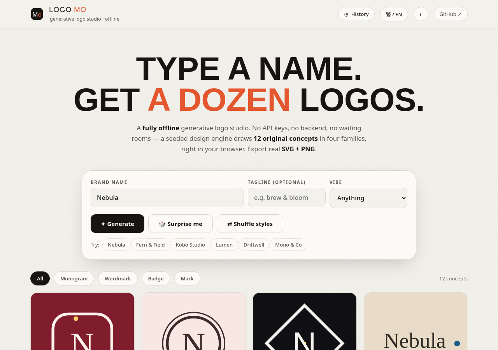

# Logo Mo — Offline Generative Logo Studio

**Type a name. Get eighteen logos.** A fully offline, zero-dependency generative logo studio that draws 20 original logo concepts in ten signature styles — right in your browser. No API keys, no backend, no waiting rooms.

**Live demo:** https://artzdesignmo.github.io/logo-mo/

## Features

- **Seeded design engine** — the same name always generates the same set; shuffle for fresh variations. Deterministic, no AI calls.
- **10 style engines** — Minimal, Monoline, Geometric, Wordmark, Emblem, Gradient, Japanese, Bauhaus, Kandinsky, Diagram (editorial diagram vocabulary after cathrynlavery/diagram-design: Venn, loop, nested, radar, quadrant, tree, pyramid, polar). Each style draws from a library of mathematically-constructed marks with generous negative space, optical centering and strict two-color discipline. Archetypes never repeat within a style per generation; scale, position and rotation are jittered for variable randomness.
- **12 curated palettes** + 6 open display fonts, shortlisted per vibe (Tech, Food, Fashion, Finance, Wellness, Creative, Travel, Playful).
- **Detail studio** — click any concept for palette variants, a business-card mockup, an app-icon mockup.
- **Real exports** — SVG (infinitely scalable), PNG at 512 / 1024 / 2048, copy-SVG-to-clipboard. PNG exports automatically embed the display font, so exports match the screen pixel-for-pixel.
- **History** — last 12 brands saved in localStorage, one click to revisit.
- **Bilingual** EN / 繁體中文, **day/night** studio themes, keyboard-first (Enter to generate).

## Usage

Open `index.html` — that's it. No build, no install, no server.

1. Type a brand name (+ optional tagline), pick a vibe.
2. Hit **Generate** — 20 concepts appear instantly.
3. Click a concept to open the detail studio: try palette variants, preview mockups, export SVG/PNG.

## How it works

A seeded PRNG (`xmur3` + `mulberry32`) drives everything: palette harmony selection, font pairing, style and mark-archetype choice. Each concept is pure inline SVG generated by one of ten style generators — no canvas, no libraries, no AI calls. The PNG exporter serializes the SVG, embeds the webfont as a data URI, and rasterizes via an offscreen canvas.

## Tech

Vanilla HTML + CSS + JS (ES6), zero dependencies. The only external request is Google Fonts for display type; after first load the app works fully offline.

## License

MIT — see [LICENSE](LICENSE).

## Support

These open-source Mo projects are built in the open and free to use.
If one of them saved you time or made you smile, you can support the next build:

**[Buy Me a Coffee — @whynotartmoney](https://buymeacoffee.com/whynotartmoney)**

Support is optional and never gates any feature — every project stays MIT-licensed and fully offline.
